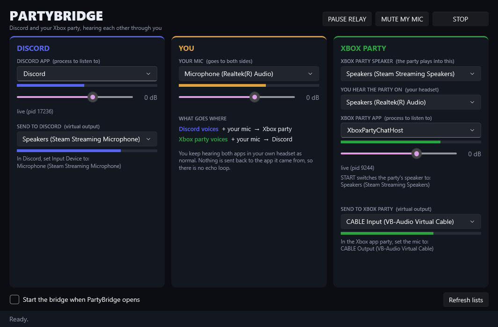

<p align="center"></p>

# PartyBridge

Lets people in a Discord call and people in an Xbox party (on PC) hear each other through you.

- Discord voices + your mic go into the Xbox party.
- Xbox party voices + your mic go into Discord.
- You keep hearing both apps in your headset as normal.

Nothing is sent back to the app it came from, so there is no echo loop.



## Download

Grab `PartyBridge.exe` from the [latest release](https://github.com/XxVoidicxX/PartyBridge/releases/latest) and run it. No installer needed.

You need:
- Windows 10 (build 20348 or later) or Windows 11
- The [.NET 10 Desktop Runtime](https://dotnet.microsoft.com/download/dotnet/10.0) (Windows offers to install it on first launch if it's missing)
- [VB-Cable](https://vb-audio.com/Cable/) (free)
- Steam, for its Steam Streaming Microphone and Speakers devices
- Discord and the Xbox app (party chat) on the same PC

If you build from source, `install.bat` copies the exe to `%LOCALAPPDATA%\Programs\PartyBridge` and adds a Start menu shortcut.

## How it works

PartyBridge listens to Discord directly (Windows per-app audio capture). Windows keeps the Xbox party chat stream out of per-app capture, so the party instead plays into an unused device, `Speakers (Steam Streaming Speakers)`. PartyBridge records that device, sends it to Discord, and plays it into your headset so you still hear the party. It needs two virtual mics, one per side:

| Side | PartyBridge sends into | That app's mic must be |
| --- | --- | --- |
| Xbox party | `CABLE Input (VB-Audio Virtual Cable)` | `CABLE Output (VB-Audio Virtual Cable)` |
| Discord | `Speakers (Steam Streaming Microphone)` | `Microphone (Steam Streaming Microphone)` |

The Steam Streaming Microphone comes with Steam and works as a second virtual cable. It ships with its recording level at +30 dB, so PartyBridge resets it to 0 dB when you press START.

## Setup

1. Run `PartyBridge.exe`. When building from source, `start-bridge.bat` opens `dist/PartyBridge.exe` with the bridge already running. The defaults should already be right: your Realtek mic, `Discord`, `XboxPartyChatHost`, and the two outputs above. Press **START**.
2. **Discord:** User Settings > Voice & Video > Input Device = `Microphone (Steam Streaming Microphone)`. Output stays on your headset.
3. **Xbox party:** set the party mic to `CABLE Output (VB-Audio Virtual Cable)`. You don't need to change the party speaker: on START, PartyBridge switches the party chat app's output to `Speakers (Steam Streaming Speakers)` (the Windows per-app output setting), and STOP or closing PartyBridge switches it back. This only works while the party's speaker is "Default" in the Xbox app. If PartyBridge crashes while running, set the party output back to Default in Settings > System > Sound > Volume mixer.
4. Pick your headset under **YOU HEAR THE PARTY ON**.
5. Each column shows a live check of what that app is really recording from, and where the party is playing. Both should say **OK: ... is listening to the bridge**. Red **Echo loop** means an app is on the other side's cable.

Recommended Discord voice settings: Automatic Gain Control off, Noise Suppression None or Standard (Krisp can treat the other voices as noise), Voice Activity sensitivity low, and Attenuation off.

## Controls

| Control | What it does |
| --- | --- |
| START / STOP | Runs the bridge |
| MUTE MY MIC | Your mic goes silent on both sides; the relay keeps going (Ctrl+Alt+N) |
| PAUSE RELAY | Stops passing voices across; your mic still goes to both (Ctrl+Alt+P) |
| Sliders | Volume of your mic, of Discord voices into Xbox, and of Xbox voices into Discord. Double-click resets |

If Discord or the Xbox app restarts, PartyBridge finds it again by itself. Settings are saved in `%APPDATA%\PartyBridge\settings.json`.

## Troubleshooting

- **What PartyBridge changes:** the Steam Streaming Microphone recording level (+30 dB to 0 dB) and the Xbox app's output device. Both are written to `%APPDATA%\PartyBridge\restore.json` first and put back on STOP, when Windows shuts down, or on the next launch if it was killed. `PartyBridge.exe --restore out.txt` puts them back by hand.
- **VR:** SteamVR (Steam Link / Quest) uses the Steam Streaming Microphone and Speakers as your headset mic and audio. While PartyBridge runs, it shares those devices with VR.

- **One side hears nothing from the other:** check the column status says `live (pid ...)` and that its meter moves when someone talks. If the Xbox meter never moves, pick a different process in the Xbox party app box (the list shows every app that is playing audio).
- **Voices drop in and out:** Windows Sound > More sound settings > Communications > "Do nothing", so Windows doesn't duck the apps.
- **Command line checks:** `PartyBridge.exe --selftest out.txt` (add `tones` to also play a quiet tone through both cables) and `PartyBridge.exe --probe out.txt` (device levels and which app records from which mic).

## Build

```
cd src
dotnet publish -c Release -r win-x64 --self-contained false -p:PublishSingleFile=true -o ../dist
```

.NET 10 WPF + NAudio. Needs Windows 10 build 20348 or later for per-app capture.
